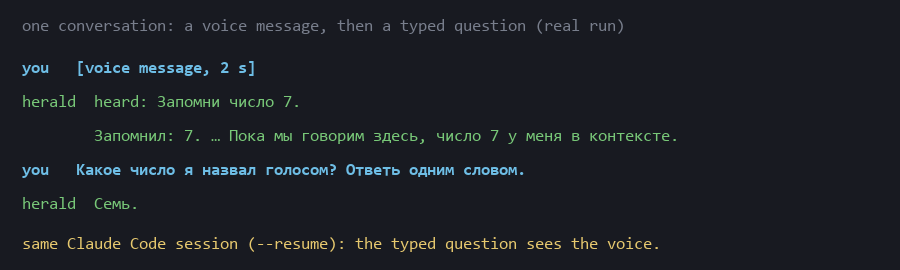
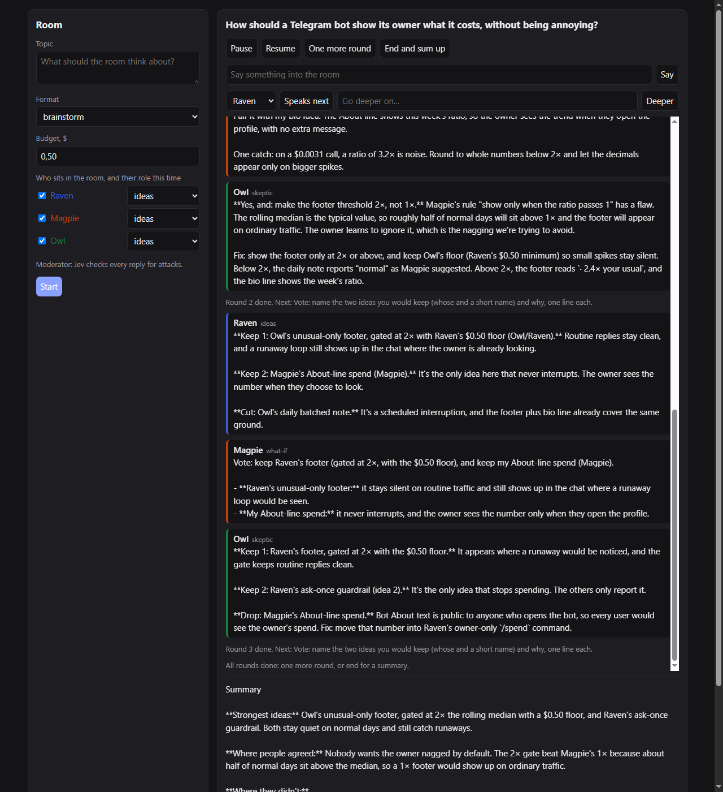

# herald

**Claude Code in your Telegram, with a voice, locked to one folder.**

> RU: Claude Code в твоём Telegram — отвечает текстом и голосом, может написать первым в заданных пределах и не выходит за свою папку. Защиту держит сам Claude Code (`--restricted`), а herald перед стартом проверяет её живой канарейкой.

You write to a Telegram bot; herald runs one Claude Code turn in a workspace folder and answers in text, and in a
voice message if you want (local speech, no cloud). It can also write first, on a schedule, inside limits written in
code, and it learns from its own sessions, with your approval. Small: about 3,200 lines of Python, standard library plus optional `piper-tts` for the voice.

## Try it in one minute (after the bot exists)

**What you need first**

- [Claude Code](https://docs.anthropic.com/en/docs/claude-code), logged in (run `claude` once and sign in). herald is
  built and checked on 2.1.310. Your Claude Code must have the `--restricted` flag — it is the lock herald relies on
  (it removes the tools that run commands or code). Check: `claude --help` lists `--restricted`. If it does not,
  herald will not start a turn; `doctor` says so.
- Python 3.10+.
- A Telegram bot token from [@BotFather](https://t.me/BotFather) (`/newbot`, pick a name, copy the token).

**What `doctor`'s canary is:** a real Claude turn in a throwaway folder that is told to read and write files outside
it, by several ways out, and to write one file inside. The disk is checked afterwards, not the model's report. PASS
means nothing outside was read or written and the inside write happened, on your machine, with your Claude Code
version. It shows what it saw today; it is not a proof for the next version — run `doctor` after every
Claude Code update.

```sh
git clone https://github.com/klavdiy-core/herald && cd herald
export HERALD_TELEGRAM_TOKEN=123456:your-token        # PowerShell: $env:HERALD_TELEGRAM_TOKEN="123456:your-token"
python -m herald init                                 # then open your bot in Telegram and send it the six-digit code
python -m herald doctor --config control/config.json  # PASS/FAIL per check: claude flags, token (getMe), canary
python -m herald run --config control/config.json
```

`init` checks the token, prints a six-digit code and makes whoever sends that code to the bot the owner (messages from before init, or without the code, do not count; no user id to look up), and writes
`control/config.json` (a $5 daily cap, voice off) and `control/persona.md`. It never overwrites an existing file. For
every option, see `config.example.json`.

Voice (optional): `pip install piper-tts`, `python -m piper.download_voices en_US-lessac-medium --download-dir voices`,
`ffmpeg` with libopus on PATH, put the `voice` block back. Then `/voice both` in the chat.

## What keeps it in its box

Claude Code does the confining, not herald's own code. Every turn runs with fixed flags that no config can remove:

```
claude -p --restricted --permission-prompts none --permission-mode acceptEdits
       --strict-mcp-config --setting-sources "" --settings '{"permissions":{"deny":[...]}}'
```

- `--restricted`: no shell or code-running tools, no WebFetch, file tools only inside the workspace, your own
  settings and hooks are not loaded.
- `--permission-prompts none`: anything that would ask a human is denied (nobody is at the keyboard).
- `acceptEdits` lets it write inside the workspace; the deny rules keep `CLAUDE.md`, `.claude/`, `.git/` and
  `.mcp.json` out of reach even there.
- The prompt goes on stdin, the child process gets an allow-listed environment (no bot token, no API keys unless you
  opt in), every turn has a turn, money and wall-clock limit.

**`herald doctor` checks it on your machine before every start.** A live turn is told to read outside the workspace
five ways (a relative `../` path, an absolute path, a link inside the workspace pointing out, Grep and Glob with an
outside path; each with its own token, so a breach names its way out), to write outside, give itself Bash in
`.claude/settings.json`, write a git hook and a `CLAUDE.md`, and to write one allowed file. The disk is checked
afterwards, not the model's words, and the canary says only what it saw: every outside read must have been tried and
refused, or the result is "inconclusive"; the same for the four forbidden writes. A run where the model tried too
little is run again, up to three times (the same model may refuse every step once and do all of them the next time);
a breach is final at once. If even the allowed write is missing, the canary proves nothing and doctor
fails. It found two real holes while herald was being built: without `acceptEdits` the model could not write at all,
and with it alone it could write `CLAUDE.md`. It tests Claude Code's confinement on this machine, today; it is not an
OS sandbox, so run `doctor` after every Claude Code update.

A boundary audit (three independent read-only reviews, 25.10.2026) found six ways around the box; each is closed with
a test that was red before:
- control/ inside the workspace on a first start, through letter case on Windows (`C:/h/WS` vs `C:/h/ws/control`):
  the check now compares paths case-insensitively.
- a `persona_file` or `agents_dir` inside the workspace let the model rewrite system prompts: refused at start.
- the speech-to-text and voice programs inherited herald's whole environment, bot token and Jev key included: they
  now get the same allow-list as a claude turn (plus GPU and model-cache variables, and their own `"pass_env"`).
- `/learn` showed 400 characters of a proposal while `/approve` kept all of it: a cut proposal now waits for `/show N`.
- a `/stop` that came during a room's last reply still bought a paid summary, and a running room reply was not
  killed by `/stop`: both now hold.

## Telegram

- Only your private chat is heard: the chat id must equal the sender id and be in `owners`. Strangers, groups, edits
  and bots are counted and never answered.
- Forwarded messages are handed to the model as data, not instructions, inside a fence with a fresh random tag per
  message (forwarded text cannot close it early); a forwarded `/stop` is not a command. `/stop@yourbot` and `/STOP` work.
- Commands: `/stop` (no turns, no speaking first, until `/resume`) · `/resume` · `/new` (fresh conversation) ·
  `/voice off|voice|both` · `/status` · `/usage` · `/retry` · `/model NAME|default` · `/room TOPIC` · `/recall WORDS`.
- The token never appears in errors or logs.
- `/stop` is handled before anything else and needs no state: a broken state file cannot block it. A state file that
  cannot be read is kept as `*.bad`; speaking first then stays quiet until you write. An update that crashes its
  handler is logged and passed, never polled again in a loop.

## Hearing: voice and text in one conversation

Send a voice message: herald transcribes it locally and puts it into the **same** Claude Code session as your typed
messages. Speak, then go on typing; it remembers what you said.



Add a `hearing` block to the config (`pip install faster-whisper` for the default program):

```json
"hearing": {"timeout_s": 120, "max_mb": 10}
```

The reply starts with `heard: …` so you see what it understood; only the answer is spoken back. Any program can do
the hearing (`"stt_cmd": [...]`, audio path appended, transcript on stdout). The default tries the GPU and falls back
to the CPU when CUDA libraries are missing. A long message (over `max_mb`) is not downloaded; anything that fails
gets "I couldn't hear that one. Please type it." Spoken words are never commands: saying "slash stop" stops nothing.

## Speaking first

Off until `speak_first.enabled` is true. Then a job (`"at": "09:30"` or `"every_min": 60`) may produce a message only if:
no `STOP` file, not in quiet hours, under the daily cap, past the minimum gap, and you answered the last messages. The
model can always choose silence by answering `[SILENT]`. A job is not spent while the gate is closed, and a long sleep
gives one message, not a burst.

## Learning: it gets better at your work, and you approve every lesson

After a session, send `/learn`. herald reads that session's Claude Code transcript and looks for three things:
an error that happened again and again, the step that finally made a failing step work, and a place where you said
"no, that didn't work". It answers with numbered proposals:

```
1. [skill] bash-pitfalls: Bash pitfalls (1) — seen 3 times (Bash), ...
2. [memory] A claim the human corrected — 2026-10-24T10:41:00Z
/approve N · /drop N
```

The list shows the text that would be kept, so nothing is approved blind; what is learned already is not offered
again, and after `/new` it reads the session that just ended. `/approve 1` keeps it. From then on every turn gets your
approved memory and skills in its system prompt. `/memory` shows what it keeps, `/forget N` removes a line,
`/forget skill-name` takes a skill out (it is archived, not deleted). The store lives in `control/learned/`, where the model cannot write:
it learns nothing you did not approve. After a long turn it reminds you once: "/learn to keep what worked".

**It can also ask, mid-conversation.** When Claude notices something worth keeping (a fact about your setup, a fix
that worked), it adds `[[remember: one sentence]]` to its answer. You see that line as a "Remember this?" message
with Keep / Drop buttons, not as raw text; Keep adds it to memory (no turn, no cost), Drop forgets it. At most three
per answer, each capped at 300 characters, and a line already in memory is not offered again.

**A lesson is a cause, not a neighbour.** A step that merely came after a failure is not proposed as its fix.
Each candidate is judged:
- a **cause**: the fix touched what failed (read or rewrote the same file, installed the missing module, ran the same
  code from a file instead of an inline `-c` string);
- a **coincidence**: a neighbouring step that touched nothing the failure was about ("the error went away after `cd`"),
  or just another attempt;
- a **bypass**: going around a check (Edit says the text is not there and the shell rewrites the file anyway; a gate
  passes only with `-SkipGate`). Never a lesson; the right move is shown (read the file again; fix what the check says).

Coincidences and bypasses are listed apart under "Not lessons", so nobody learns them by mistake. And a lesson must
happen in at least two different sessions (`learn_min_sessions` / `--min-sessions`, default 2): one bad afternoon is
not a habit. Checked on a real team's sessions: "internal went away after cd" lands as a coincidence and "Edit could
not find the string, so PowerShell appended to the file" as a bypass.

The analysis is plain code, no model. On real sessions it ignores what is not a mistake: red test runs done on
purpose, a failing test fixed by editing code (that is the job), text injected by skills, long briefs that happen to
say "again". A skill is one per tool ("Bash pitfalls"), never one per error message.

It works on any Claude Code transcript too, without Telegram:

```sh
python -m herald learn ~/.claude/projects/<project>/ --private --out proposals.md   # a folder of sessions, or one
```

`--private` keeps only the mechanics (tools, error lines, what fixed them) and drops every quoted message; words the
human typed that could be private (with digits, ALL CAPS, names inside a sentence) are masked even when an error line
echoes them.
`--ignore REGEX` marks outputs that are signals, not failures.

For a team of sessions (each started with `claude --name <role>`), one call reads a whole project folder:

```sh
python -m herald team ~/.claude/projects/<project> --out shared/ --since-hours 24
```

It writes one proposals file per role and an `INDEX.md` with the errors more than one role keeps hitting: those are
the rules worth writing for everyone. It is private by default: an output line that does not read as an error is
withheld (it may be a message someone typed), and commands are cut to the program and its first argument.

**Search past sessions.** `/recall pricing page` finds what was said in earlier sessions (your messages, including
ones sent mid-turn, and the model's text; never tool outputs, which hold file contents) and shows each match with the
reply that followed. It is an SQLite FTS5 index in `control/recall.db`, built only from what is new since the last
search; no model, no cost. Without Telegram: `python -m herald recall <sessions folder> --query "pricing page"`.
On a real 35 MB session the first index took about a second, later searches 0.3 s.

The idea (memory and skills in the prompt, nudges after hard work, umbrella skills, "do not save one-off failures",
search over past sessions)
comes from [Hermes Agent](https://github.com/NousResearch/hermes-agent) by Nous Research, MIT; no code is copied.
The difference is not who writes: Hermes can also hold its writes for approval (`skills.write_approval`,
`memory.write_approval`, off by default) and keeps a log with rollback. Here there is no model in the learning loop
at all (proposals come from plain code reading the transcripts), and approval is not a setting: nothing is kept
without `/approve` or a Keep tap.

## Buttons: decide with one tap

When the owner should pick between options, the model ends its answer with `[[choices: Rewrite | Patch it]]`
(every turn is told how). herald turns that into buttons, adds **Postpone**, and sends the pick back to the model as
the next message. A room's summary comes with **Accept / One more round / Postpone**; Accept is written into the
room's record.

- A tap counts once: a double tap gets "Already decided", not a second turn.
- Each choice has a lifetime (`decision_ttl_s`, a day by default). A postponed or ignored one expires and is reported
  once, in one line; the buttons are not pushed again.
- Only the owner's taps in the private chat are heard; anything that does not match a live decision exactly is
  refused. Decisions live in `control/decisions.json`, so a tap still works after a restart.

Checked live: asked to help pick a bot name, haiku answered with buttons (Pebble / Echo / Lark / Postpone); the tap
on Echo came back to it and it went on from there.

## The room: agents discuss, you watch and steer

`python -m herald room --config control/config.json` opens a small page on your machine (127.0.0.1, a random token
in the link). You pick who sits in the room and the role each plays this time (ideas, skeptic, specialist, what-if,
goal-keeper, moderator, or your own words), a format and a budget, then watch them talk in turns:

- **brainstorm**: ideas only, no evaluation → "yes, and" on someone else's idea → vote for two to keep;
- **decide**: options → pros, cons and cost → a recommendation and what would change it.

Every participant speaks in its own voice and sees what the others said. You can pause, say something into the room,
choose who speaks next, ask to go deeper on a point, add a round, or end it: a summary comes back and the whole
discussion is saved under `control/rooms/`. Money is counted per reply and the room stops at its budget. A reply sent back by the moderator to be rephrased is a paid reply too: it starts only if it fits, otherwise the reply is held back and the room says why; the closing summary takes the same test. A participant with no per-reply cap reserves nothing, so its one reply can still go past the budget: set the cap. The daily cap holds each paid call before it starts (a reserve row in control/costs.jsonl under a lock, released when the real cost is written), so the bot and a room running at once cannot both spend the last cents (0.23.2; before, both could pass the check and pay a full reply each). The browser room still checks before and writes after. (found by an external review, fixed in a3c8c98).

**No attacks, enforced, not hoped for.** With `TYPESAFE_API_KEY` set, [Jev](https://typesafe.ai) (a model that
answers narrow questions with a probability) checks every reply: an attack on a person is sent back once to be said
about the idea; a second one is held back. Firm criticism of an idea passes. Checked live: 5 of 5 test phrases judged
right (attacks 0.96-0.97, hard criticism and agreement 0.02-0.05). If Jev is unreachable, replies go through (the
check fails open). **Every room reply goes to TypeSafe** while the key is set — leave `TYPESAFE_API_KEY` unset if the
room's text must not leave your machine.



Participants are listed in the config. A Claude role answers through the same confined turn as herald, one fresh
turn per reply, Read as its only tool, in its own empty folder under `control/agents/`. Anything else is a command
that reads the question (on stdin, or as its last argument) and prints the answer, run in its own empty folder:

```json
"agents": [
  {"name": "Raven", "kind": "claude", "model": "claude-haiku-5-5", "character": "Sharp and bold."},
  {"name": "Owl", "kind": "claude", "model": "claude-sonnet-5-5", "character": "Calm, keeps an eye on cost."},
  {"name": "Gemini", "kind": "command", "command": ["gemini", "-p"], "prompt_arg": true}
],
"room": {"port": 8765}
```

**Voices.** Give an agent `"voice": {"model": "voices/ru_RU-irina-medium.onnx"}` and tick "Voices" on the page:
each reply is read aloud in its own voice, one after another (local piper, no cloud; markdown and code are not read;
the audio is cached per reply). With `/voice both` in Telegram, a room's summary comes as a voice message too.
Checked live with four Russian piper voices (dmitri, ruslan, irina, denis): every line came back intelligible through
speech recognition.

**Team skills.** A team can keep its shared skills in a git repository: `skills/<name>/SKILL.md` (front matter with
`name` and `description`) and `roles/<Role>.md` (one line per skill the role has, the name in backticks). With
`"team_skills": {"repo": "path/to/clone", "role": "Raven"}` in the config (and `"skills_role"` on each room agent),
every role pulls the repository when it starts, gets a table of contents of its own skills in its system prompt, and
a copy of those SKILL.md files in its own folder, where its confined Read can open one when it fits. Other roles'
skills are not given to it; a skill taken away from a role disappears from its folder; a SKILL.md without a name or
description is skipped and logged; if the pull fails, the local copy is used.

**What is confined and what is not.** A Claude role is confined like every herald turn (Claude Code's
`--restricted`, its own empty folder, Read only). A `command` agent is an ordinary program you chose: herald only
gives it an empty folder of its own and the same allow-listed environment as a Claude turn (no bot token, no
`TYPESAFE_API_KEY`); a CLI that needs its own key names it in `"pass_env": ["ITS_KEY"]`. A command agent is an ordinary program: it is not confined like a Claude turn, and its price is unknown to herald, so it counts as $0 unless you set `"cost_per_call_usd"` on it. Room agents live in their own root (`herald-agents/` next to `control/`, or `"agents_dir"`), outside `control/` and the workspace. Treat a command agent as
code you run yourself. On Windows a `.cmd`/`.bat` target with `"prompt_arg": true` is refused at start: cmd.exe
would read `&` or `>` in the prompt as commands. Point it at the real `.exe`, or send the prompt on stdin.

`WebSearch` can be added to `"tools"`, but it is a way out: search queries leave your machine and can carry text the
turn read in the workspace. `herald doctor` says so (WARN) whenever it is on.

`/stop` and the daily cap are checked before every reply in a room, in Telegram and in the browser alike, not only
when it starts; a stopped room says so and makes no summary. Its spend goes into the ledger reply by reply. The
browser room has a default budget (`room.budget_usd`, $0.50) and runs one room at a time.

The room in the picture: three haiku roles, three rounds and a summary, 67 seconds, $0.008. A room of three Claude
roles and Gemini (through its own CLI) deciding herald's next feature took 121 seconds and $0.013.

From Telegram: `/room <topic>` seats every agent from the config (with its `"role"`), runs the three brainstorm
rounds and sends the summary to the chat. Its money goes into the same daily ledger and cap.

## What it costs, and how to spend less

Measured on live turns (Claude Code 2.1.310, a three-word answer, default five tools):

| | cost of one turn | context read |
|---|---|---|
| claude-haiku-5-5 | $0.0002 - 0.0005 | ~6,000 tokens |
| claude-sonnet-5-5 | $0.0069 | ~5,400 |
| claude-opus-5-5 | $0.0137 | ~5,400 |

About 6,000 tokens of every turn is Claude Code's own system prompt; a resumed session hits the cache, but each turn
re-reads the whole conversation so far, so long sessions cost more per turn. Tools cost too: `"tools": ["Read"]`
reads ~2,000 fewer tokens than the default five. A large persona or many approved lessons make the first turn of a
session dearer (about 3x for +5,000 tokens).

- `/status` shows today's spend and turns; `/usage` shows today against the cap and the last seven days, with how many costs are estimates (a killed turn is counted at its cap); every turn goes into `control/costs.jsonl` (dollars, context tokens). `/retry` runs the last request again (kept in memory only, so not after a restart).
- `"max_usd_per_day": 1.0` in the config stops turns and speaking first once today's spend reaches it.
- `/model claude-haiku-5-5` switches the model from the next turn (kept across restarts); `/model default` goes back.
- `/new` starts a fresh, cheap session when a long one gets expensive.
- **Small messages to the small model, decided by Jev** (opt-in): with `"jev": {"route_simple": "claude-haiku-5-5"}` in
  the config and `TYPESAFE_API_KEY` set, each message is first shown to [Jev](https://typesafe.ai) with one question —
  can a small, fast model answer this as well? Above `route_bar` (default 0.7) the turn runs on the small model.
  Measured live: greetings, short facts and rewording scored 0.96-0.98; refactoring, debugging, planning and
  comparing options 0.07-0.26. Your `/model` always wins; if Jev is unreachable the configured model answers; `/status`
  names the routed turn. **The message text goes to TypeSafe** — that is why it is off by default.

## Jev in /learn: lessons, not noise (opt-in)

`"jev": {"learn": true}` (bot) or `herald learn ... --jev` (command line) asks Jev of every proposal: a reusable
lesson (a cause and a thing to do), or noise (a one-off, a coincidence, a workaround around a check, advice too general
to act on)? Below 0.35 a proposal moves to «Jev: noise, not lessons» with its probability — not deleted, you can still
approve it. Measured live: «re-read the file before Edit» 0.91, «write a small Python patch instead of a multi-line
PowerShell replace» 0.80; «cd fixed it» 0.06, «be careful» 0.03, «call it again with -SkipGate» 0.06. The proposals'
text goes to TypeSafe, so `--jev` is refused together with `--private`; in the bot the drafts are the masked ones.

## Limits, honestly

- Hearing is as good as the speech model: the default `small` model is a fair compromise, `--model medium` hears
  better and slower.
- The voice speaks short plain answers only (no code, no tables, under 600 characters), and a Russian voice reads
  Latin words badly ("herald" comes out as "Эволд").
- The canary is checked with Claude Code 2.1.310 on Windows. Run `doctor` after every Claude Code update.
- One worker: messages are handled one at a time. While a turn runs, herald keeps listening: `/stop` is acted on at
  once and kills the running turn within about a second (its cost is counted as the turn's whole cap, since the
  real figure is lost with it); other messages and button taps wait and are handled after it, in order.

## Test

```sh
python -m unittest discover -s tests
```

357 tests against a fake `claude`, a fake Bot API, a fake `piper` and a fake speech-to-text; each module was also checked with planted
breaks (the tests must go red). Live: the canary, a two-turn `--resume` smoke, an end-to-end run with a real Claude turn
and a real voice message out through a fake Bot API, and a voice message in (real piper voice, real faster-whisper)
followed by a typed question in the same session; the learning loop with a real turn (an approved memory line
changed the next answer), and `learn` on three real Claude Code sessions.

## License

MIT
